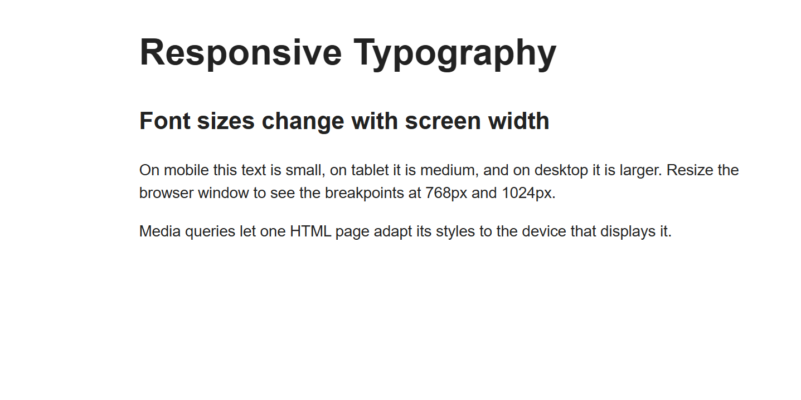
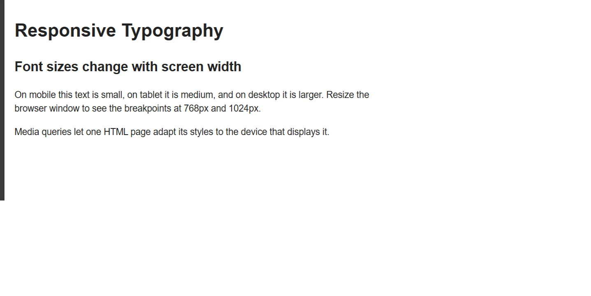
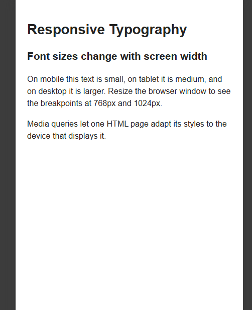

ASSIGMENT3-RESPONSIVE WEB DESIGN
NAME:Van Alexander
GROUP:SE-2540

TASK0-RESPONSIVE TYPOGRAPHY:

A simple page with headings and paragraphs.

DEKSTOP:

TABLETS:

PHONE:

TASK1-Responsive Layout with Media Queries:

Three boxes: three in a row on desktop, two in a row on tablet, stacked on mobile. Made with CSS media queries only, without Bootstrap.

DEKSTOP:

TABLETS:

PHONE:

TASK2- Bootstrap Grid System:

Three columns with the classes `col-12 col-md-6 col-lg-4`: three in a row on desktop, 2 + 1 on tablet, stacked on mobile.

DEKSTOP:

TABLETS:

PHONE:

TASK3-Bootstrap Navigation Bar

A responsive navbar with the logo on the left and links on the right. On smaller screens it collapses into a hamburger menu (`navbar-expand-lg`).

DEKSTOP:

TABLETS:

PHONE:

TASK4-Responsive Portfolio Page

A portfolio page with a navbar, project cards on the left, a sidebar on the right and a footer.

DEKSTOP:

TABLETS:

PHONE

CONCLUSION:
In this assignment I learned how to make web pages that adapt to different screen sizes. I used CSS media queries with a mobile-first approach and the Bootstrap 12-column grid with responsive classes such as `col-12 col-md-6 col-lg-4`. I also built a collapsible navbar and combined Bootstrap components with my own media queries in the final portfolio page. The main thing I understood is that the same HTML can have a different layout on mobile, tablet and desktop only by changing the CSS rules at certain breakpoints.

